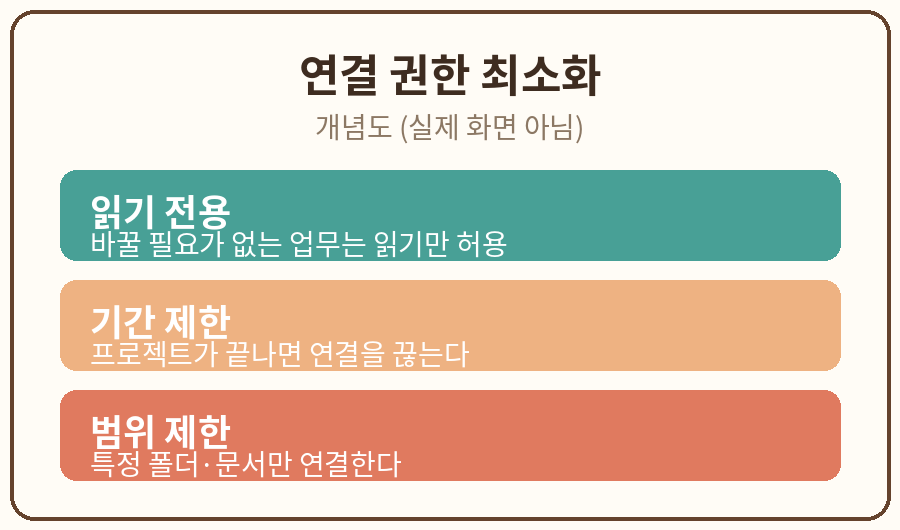

# 3장. 연결 권한 최소화

## 학습 목표

1. 최소 권한 원칙을 설명하고 업무별로 필요한 권한을 고를 수 있다.
2. 읽기 전용과 기간 제한 설정을 실습에 적용할 수 있다.

## 선행 개념

2장에서 AI에 넣어도 되는 자료와 안 되는 자료를 구분했다. 이 장에서는 AI가 외부에 접근하는 범위를 다룬다. 에이전트가 메일함을 읽거나 파일을 만들려면 "연결"이라는 설정이 필요하다. 이때 주는 권한의 범위가 핵심이다.

용어 정리:
- 최소 권한 원칙: 일을 하는 데 꼭 필요한 권한만 주는 원칙. 보안의 기본이다.
- 읽기 전용: 보기만 가능하고 바꾸거나 지울 수 없는 권한.
- 기간 제한: 연결을 일정 시간이 지나면 자동으로 끊는 설정.
- 권한 매트릭스: 업무별로 어떤 권한이 필요한지 정리한 표.

## 쉬운 설명

집 열쇠를 예로 들어 보자. 집 청소를 부탁하면서 대문 열쇠, 금고 열쇠, 차 열쇠를 전부 건네는 사람은 없다. 대문 열쇠만 주고, 청소가 끝나면 돌려받는다. AI 연결도 같다.

AI에게 회의록 요약을 맡긴다고 하자. 필요한 것은 회의록 파일 읽기 권한뿐이다. 그런데 삭제 권한까지 주면, AI가 실수로 파일을 지울 수 있다. 공유 권한까지 주면, AI가 파일을 외부에 보낼 수 있다. 1장에서 배운 행동 분류(읽기, 쓰기, 전송, 삭제)를 떠올려 보자. 읽기만으로 되는 일에 쓰기 권한을 주지 않는 것이 최소 권한 원칙이다.

OpenAI의 프롬프트 인젝션 안내에서도 비슷한 조언을 한다. 에이전트에게 꼭 필요한 자료나 자격 증명에만 접근을 허용하고, 민감한 단계 전에는 확인을 받으라고 권한다 [S4]. 필요 이상으로 넓게 열어 두면, 숨은 지시 같은 공격에 노출되는 면도 넓어진다.

실무에서 자주 쓰는 세 가지 제한이 있다.

1. 읽기 전용: 바꿀 필요가 없는 업무는 읽기만 허용한다.
2. 기간 제한: 프로젝트가 끝나면 연결을 끊는다. "이번 주까지만" 같은 식이다.
3. 범위 제한: 전체 메일함이 아니라 특정 폴더만, 전체 파일이 아니라 특정 문서만 연결한다.

## 가상 데이터 예시



아래는 이 장 실습에 쓰는 가상의 파일함 구조다. 전부 만들어 낸 것이다.

가상 파일함:
- /회의록/2026-10-1차.md (읽기 필요)
- /회의록/2026-10-2차.md (읽기 필요)
- /재무/예산안.xlsx (연결 불필요)
- /인사/평가표.docx (연결 불필요)
- /공유/팀 공지.md (읽기 필요)

## 단계별 실습

1. 위의 가상 파일함 구조를 메모장에 복사해 둔다. 필요하면 가상의 예시를 새로 만들어도 된다.
2. 아래 복사용 프롬프트를 AI에 입력하고, 결과를 복사해 별도 Markdown 메모에 보관한다.
3. 결과를 원문(위의 파일함)과 대조하고, 권한 추천이 최소 권한 원칙에 맞는지 오류를 기록한다.
4. 누락된 항목을 수정해 두 번째 결과를 얻는다. 예를 들어 재무 폴더가 제외되었는지 확인한다.

### 실습 과제

가상 파일함의 권한 매트릭스를 작성한다.

### 복사용 프롬프트

```
업무: [회의록 요약]. 연결 가능한 권한은 읽기/편집/삭제/공유다. 꼭 필요한 최소권한만 추천하고 불필요한 권한의 이유를 설명해줘.
```

### 예상 결과

AI는 대략 다음과 같은 매트릭스를 돌려준다.

| 대상 | 읽기 | 편집 | 삭제 | 공유 | 판단 |
|------|------|------|------|------|------|
| 회의록 폴더 | 필요 | 불필요 | 불필요 | 불필요 | 요약에는 읽기면 충분 |
| 재무 폴더 | 불필요 | 불필요 | 불필요 | 불필요 | 업무와 무관하므로 연결 제외 |
| 인사 폴더 | 불필요 | 불필요 | 불필요 | 불필요 | 민감 자료이므로 연결 제외 |
| 팀 공지 | 필요 | 불필요 | 불필요 | 불필요 | 참고용 읽기만 허용 |

### 흔한 오류와 해결책

- 오류: 편집 권한도 함께 추천했다. 해결: "요약"에는 원본을 바꿀 이유가 없다는 점을 지적하고 다시 묻는다.
- 오류: 기간 제한을 빠뜨렸다. 해결: 매트릭스에 "연결 기간: 이번 주까지" 같은 항목을 추가한다.

## 자가 점검표

- [ ] 결과 파일 저장
- [ ] 사실·형식 검토
- [ ] 개인정보 없음
- [ ] 수정 전후 비교

## 관련 공식 출처

- [S4] OpenAI, "Understanding prompt injections: a frontier security challenge", 2025-11-07, https://openai.com/index/prompt-injections/ (2026-10-11 열람)
- [S1] Anthropic, "Investigating unintended model actions in our evaluations and internal use", 2026-10-09 공개 (2026-10-11 열람)
